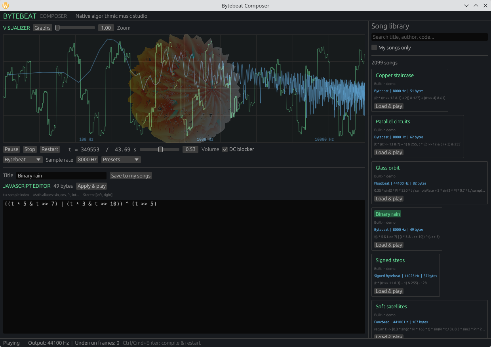

# Bytebeat Composer (native Rust)

A standalone desktop bytebeat studio inspired by
[Dollchan Bytebeat Composer](https://github.com/SthephanShinkufag/bytebeat-composer).
Compose JavaScript audio, play built-in demos, and explore waveform, spectrum,
bit-pattern, and shader-art visualizers. This is an independent native
implementation: no browser or server required. Built-in demos work offline;
the optional upstream song library downloads on demand.



## Install or run

Download a platform installer from [Releases](https://github.com/ycollet/bytebeat/releases),
or run from source with a current stable Rust toolchain:

```sh
cargo run --release
```

See [installation and build requirements](DOCUMENTATION.md#installation-and-building)
for native dependencies, supported platforms, and installer instructions.

## Quick start

Select a demo from the library, or enter a JavaScript expression in the editor.
Choose the appropriate mode and sample rate, then click **Apply & play** or
press **Ctrl+Enter** / **Cmd+Enter**. Start at a low volume.

For a simple tone, choose **Bytebeat** at **8000 Hz**:

```js
(t * 8) & 255
```

Use **Graphs** to configure visualizers and **Save to my songs** to keep a
composition in your local library.

## Documentation

[DOCUMENTATION.md](DOCUMENTATION.md) contains the complete guide: installation,
editor and playback controls, JACK and NSM sessions, language reference and
examples, catalogs and file loading, terminal checks, visualizer development,
and architecture.
