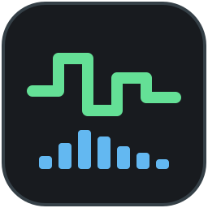

# Bytebeat Composer (native Rust)

A standalone desktop bytebeat studio inspired by the layout and workflow of
[Dollchan Bytebeat Composer](https://github.com/SthephanShinkufag/bytebeat-composer).
This is an independent implementation, not a web wrapper: one executable, no
browser or server required. Built-in demos work offline; the optional upstream
library is downloaded automatically when no local, installed, or cached catalog
is available.

For the language reference, playback semantics, and complete example programs,
see [DOCUMENTATION.md](DOCUMENTATION.md).

## Run

Install a current stable Rust toolchain, then:

```sh
cargo run --release
```

To distribute it, run `cargo build --release` and copy `target/release/bytebeat`
(`bytebeat.exe` on Windows). The executable embeds the GUI, JavaScript engine,
fonts, and eight original demo songs. It still uses the operating system's
windowing and audio libraries.

On Debian/Ubuntu, install the native build dependencies first:

```sh
sudo apt install build-essential pkg-config libasound2-dev libjack-jackd2-dev libudev-dev \
  libx11-dev libxi-dev libxrandr-dev libxcursor-dev libxkbcommon-dev \
  libwayland-dev libgl1-mesa-dev
```

macOS requires the Xcode command-line tools. Windows requires the MSVC Rust
toolchain and Visual Studio C++ build tools.

### Release installers

Pushing a version tag runs `.github/workflows/release.yml`. After all builds
and installation checks succeed, the workflow publishes installers and
`SHA256SUMS` to a GitHub Release:

| Platform | Installer | Architecture |
| --- | --- | --- |
| Debian 12+ / compatible Ubuntu releases | `.deb` | x86-64 |
| Fedora 43+ | `.rpm` | x86-64 |
| macOS | `.dmg` containing a drag-to-Applications `.app` | Apple Silicon and Intel |
| Windows 10+ | Per-user `.exe` installer with an uninstaller | x86-64 |

For an on-demand build, open **Actions → Release installers → Run workflow**
and select a branch or tag. Manual runs use the version in `Cargo.toml`, run
the same build and installation checks, and upload installers as workflow
artifacts without creating or updating a GitHub Release. The workflow must
be present on the default branch for the **Run workflow** button to appear.

Tags must be `vVERSION` or `VERSION`, matching `[package].version` in
`Cargo.toml` exactly. SemVer prereleases such as `v0.2.0-rc.1` are supported
and published as prereleases; build metadata (`+...`) is not supported.
Commit any version changes, including `Cargo.lock`, before creating the tag:

```sh
git tag v0.1.0
git push origin v0.1.0
```

Linux packages include desktop entries, the SVG icon, and runtime dependencies.
Install a `.deb` with `sudo apt install ./bytebeat_*.deb`, or an `.rpm` with
`sudo dnf install ./bytebeat-*.rpm`. The optional upstream song catalog is not
bundled; built-in demos work offline and the catalog is downloaded on demand.

Windows installers are not code-signed, and macOS apps are ad-hoc signed rather
than Developer ID-signed or notarized, so OS security warnings are expected.
No signing secrets are required. Publishing uses the workflow's `GITHUB_TOKEN`
with `contents: write` permission only in the publishing job; builds have
read-only repository access. Rerunning a failed tag workflow replaces existing
assets for that tag.

### JACK audio on Linux

Linux builds include the JACK backend. Without additional options, the app
continues to use CPAL's default audio backend. Select JACK explicitly with:

```sh
cargo run --release -- --jack
# Or use the installed executable:
bytebeat --jack --catalog /usr/share/bytebeat/catalog.json
```

Install the JACK client library and start a JACK server before launching, or
use a correctly configured PipeWire JACK setup. Where required, launch through
`pw-jack bytebeat --jack`. The application does not start the JACK server itself
and does not silently fall back to another backend if JACK cannot be opened;
failures appear in the console and GUI status bar.

CPAL attempts to connect the output ports to system playback ports automatically.
If necessary, use a JACK routing tool such as QjackCtl or your PipeWire patchbay
to connect the CPAL client's output ports. The output rate and buffer size come
from the JACK server; the song's formula sample rate remains a separate setting.

The Linux build requires JACK development files (`libjack-jackd2-dev` on
Debian/Ubuntu). For RPM packaging, `pkgconfig(jack)` and `pkgconfig(alsa)` identify
the audio development dependencies; install the runtime JACK client library or
its PipeWire-compatible implementation as appropriate for the distribution.
No JACK feature flag is needed when building this application on Linux.

`--jack` is rejected on other operating systems and cannot be combined with
`--check`, which never opens an audio device.

### NSM sessions

Bytebeat supports [New Session Manager (NSM)](https://new-session-manager.jackaudio.org/)
and compatible managers. Add `bytebeat` as a client in the session manager;
the application detects `NSM_URL` automatically, with no extra command-line flag.
On Linux, managed sessions use JACK automatically. Start JACK (or configure
PipeWire's JACK compatibility) before opening the session.

The manager's **Save** command writes the complete editor project, including
source, title, playback settings, graphs, and "My songs", to `project.json` in
the assigned client directory. Reopening the session restores that project,
independently of standalone application preferences; new sessions start with
the default project. "Save to my songs" updates the session's song collection,
but does not replace the manager's Save command. Playback starts paused.

Managed JACK ports use a stable client-ID prefix, and automatic connection to
system playback ports is disabled so the session manager's patchbay can restore
routing. Use a connection-management client such as JACKPatch to save routing.
Closing a session terminates Bytebeat without a save dialog. Session switching
and optional-GUI/dirty-state extensions are not advertised: the manager must
restart the client when changing sessions.

Without `NSM_URL`, or when the manager cannot be contacted, startup remains
standalone. Headless `--check` ignores NSM entirely. UDP OSC URLs are supported;
unsupported URLs produce a warning and use standalone mode.

### Application icon



The scalable vector icon is [assets/bytebeat.svg](assets/bytebeat.svg). It uses
the GUI's waveform/spectrum colors and contains no fonts, raster images, scripts,
or external resources. The executable embeds this SVG and renders it at startup
for the native window/application icon, including the macOS Dock icon. No
external icon file is required to run the application.

For Linux/RPM packaging, install it at
`/usr/share/icons/hicolor/scalable/apps/bytebeat.svg` and use `Icon=bytebeat`
in the application's desktop entry. The SVG remains available unchanged for
desktop packaging. File-manager and platform bundle icons still require
platform-specific packaging.

## Compose

- **Editor:** enter a JavaScript expression, then click **Apply & play** or
  press **Ctrl+Enter** / **Cmd+Enter**. Edits are applied explicitly, so incomplete
  typing does not interrupt playback. Scripts larger than **256 KiB** open in a
  read-only preview limited to **4 KiB**; playback and saving retain the complete
  source. To edit the full script, acknowledge the memory warning and click
  **Open full editor**. **Return to safe preview** restores protection. Consent
  resets when another song is loaded or the app restarts. Pasting more than
  256 KiB into a protected editor is blocked with a visible warning; enable full
  editing and paste again.
- **Playback:** Play/Pause, Stop (reset to zero), Restart, volume, sample-rate
  presets, and custom rates from 1,000 to 192,000 Hz. Playback starts paused at
  25% volume; use a comfortable listening level.
- **DC blocker:** optional checkbox beside Volume, on by default and saved with
  your settings. Removes DC offset using a first-order 10 Hz high-pass filter
  independently on the left and right channels, at the device's output sample
  rate, before volume adjustment and device conversion. It also attenuates very
  low bass; filter transients are clamped to the device's valid output range.
  Graphs still show the original, unfiltered signal. This reduces sustained DC,
  but is not a limiter or a guarantee against speaker damage: keep playback
  volume at a safe level.
- **Visualization:** open **Graphs** and use **+** to add a layer or **-** to
  remove it. Choose **Waveform**, **FFT spectrum**, **8-bit pattern**, or one of
  **35 original shader-art presets**. Each layer has a left/right/mixed channel,
  a color picker, and an opacity slider (0 is transparent; 255 is opaque).
  The Graphs menu stays open while you select and adjust layers.
  Layers overlay in list order; later layers draw
  over earlier ones. The defaults retain the stereo waveform and mixed spectrum.
  Use Play/Pause to control playback; clicking the display does not affect audio.
  Zoom adjusts the waveform and scrolling
  bit-pattern window; the spectrum always analyzes the latest 2,048 output frames
  using a Hann window. Graph settings, including an empty list, persist.
  The bit pattern shows eight horizontal bit rows (most significant at the top),
  with newer samples on the right. It maps normalized output to unsigned bytes
  (Bytebeat values are recovered exactly; other modes are quantized). All graphs
  use generated output before volume adjustment, without re-evaluating the song.

  Each graph's channel selection affects visualization only, not playback:

  | Setting | Signal displayed |
  | --- | --- |
  | **Left** | Left stereo channel only |
  | **Right** | Right stereo channel only |
  | **Mix** | Average of both channels: `(Left + Right) / 2` |

- **Shader art:** the preset selector includes blorp, seaqyuk, bhatsu, discinos,
  ?dot-line, morp, add-em-up, grid, circles, widr, fuzeball, undul, flwr, radonut,
  vu-w/max, notmizu, pulsedn, bebubebup, dncrs, discus, smutz, ball-o?3, incId,
  headrush, cubespace, s.o.i., volum, iblot, circlepower, c-pump, red ring, cybr,
  ball, qyube, and hexalicious. These are the original vertex shaders by
  **gman (Gregg Tavares)**, licensed **CC0** and bundled for offline use.
  Selecting a shader from a signal graph starts with white tint (original
  colors) and full opacity; use the color picker to tint it. Changing between
  shader presets preserves your tint and opacity. Shader layers use native
  OpenGL, depth-tested geometry, playback time, mouse position, and smoothed FFT
  and volume histories. Animation pauses with playback; histories reset when a
  song is compiled/restarted. Browser FFT/history timing may differ; touch input
  is neutral and no linked music is downloaded or played. Shader errors are
  logged and shown above the display. Multiple shader layers increase GPU cost.
  The menu links each artwork's source and attribution; licensing details are in
  [assets/VERTEXSHADERART-LICENSE.txt](assets/VERTEXSHADERART-LICENSE.txt).
- **Library:** search the included demos, load a song, or save your expression to
  **My songs**. Saving the same title replaces that local song; **x** deletes it.
  The editor, settings, and local songs persist through egui's native application
  storage when the application saves/exits. They are not written beside the binary.
  Search results are cached until the query, saved-only filter, or library changes.

## Adding a visualizer

Visualizers are built into the executable; there is no runtime import or plugin
loader. Signal graphs (waveform, FFT spectrum, and bit pattern) are implemented
in Rust in `src/visualizer.rs`. To add another signal graph, extend `GraphKind`,
its label, the Graphs menu, and the rendering match.

For shader art, no new Rust renderer is needed: append a preset to the JSON array
in `assets/vertexshaderart.json`. This uses the **VertexShaderArt-style GLSL
vertex shader** format, not Shadertoy fragment shaders or MilkDrop presets.

### Example: audio-reactive spectrum bars

This small shader draws 64 vertical lines. Each line's height follows a bin of
the selected channel's smoothed FFT spectrum:

```glsl
void main() {
    float bar = floor(vertexId / 2.0);
    float u = (bar + 0.5) / (vertexCount / 2.0);
    float level = texture2D(sound, vec2(u, 0.0)).r;
    float y = -0.8 + mod(vertexId, 2.0) * level * 1.6;
    gl_Position = vec4(u * 1.8 - 0.9, y, 0.0, 1.0);
    v_color = vec4(0.2, 0.8, 1.0, 1.0);
}
```

Append the following object **after the existing presets**, adding a comma
between objects. Existing saved layers reference preset indices, so keep the
existing order. JSON stores the GLSL code as a string; the example below is the
same shader on one line:

```json
{
  "id": "example-spectrum-bars",
  "name": "Example spectrum bars",
  "author": "Your name",
  "source": "https://example.com/your-visualizer",
  "license": "CC0-1.0",
  "settings": {
    "num": 128,
    "mode": "LINES",
    "backgroundColor": [0, 0, 0, 0],
    "shader": "void main() { float bar = floor(vertexId / 2.0); float u = (bar + 0.5) / (vertexCount / 2.0); float level = texture2D(sound, vec2(u, 0.0)).r; float y = -0.8 + mod(vertexId, 2.0) * level * 1.6; gl_Position = vec4(u * 1.8 - 0.9, y, 0.0, 1.0); v_color = vec4(0.2, 0.8, 1.0, 1.0); }"
  }
}
```

Replace the author and source with your own attribution. This example may be
used under CC0; use the appropriate license for any other shader you add.
`num` is the vertex count (two vertices per line here); supported drawing modes
are `POINTS`, `LINES`, and `TRIANGLES`. `backgroundColor` is normalized RGBA;
the transparent background lets earlier graph layers remain visible.

The renderer supplies `vertexId`, `vertexCount`, `time` (playback seconds),
`resolution`, `mouse`, and audio textures. `sound` contains normalized,
log-scaled FFT magnitudes: horizontal coordinates select frequency bins and
vertical coordinates select history, with the newest row at `0.0`.
`volume` provides peak/RMS and other audio metrics with history.
Write `gl_Position` and `v_color` in `main()`; do not add a `#version` directive
or redeclare the supplied inputs. The renderer adds the GLSL compatibility
wrapper and fragment shader.

Rebuild with `cargo run --release`, then open **Graphs**, add a layer with **+**,
and choose **Example spectrum bars** from its visualizer selector. Play a song
and select **Left**, **Right**, or **Mix** to choose its audio input. Shader
compilation errors appear above the display and in the logs.

When contributing additional presets, also update the catalog test in
`src/shader_art.rs`: it currently requires exactly 35 presets and checks that
every entry belongs to the original gman CC0 collection. Preserve those checks
for the original collection while adding coverage for new entries.

## Upstream catalog and file loading

Without `--catalog`, the application searches for an upstream catalog in this
order:

1. `./data/catalog.json`, relative to the current working directory.
2. `/usr/share/bytebeat/catalog.json` on Linux, for packaged installations.
3. `bytebeat/upstream/catalog.json` under the platform's user cache directory.
4. If none exists, download the upstream catalog and full song sources into
   that user cache.

The first automatic download runs in the background while the GUI stays usable
with its built-in demos. The song library shows progress, adds the upstream
songs when ready, and displays download errors with a **Retry download** button.
An incomplete download does not publish a cache index; verified source files
are reused on retry. Later launches use the completed cache without network
access. Supplying `--catalog` explicitly disables discovery and automatic
downloading; an invalid explicit path is reported rather than replaced.

Typical automatic cache locations are:

| Platform | Directory |
| --- | --- |
| Linux | `$XDG_CACHE_HOME/bytebeat/upstream/`, or `~/.cache/bytebeat/upstream/` |
| macOS | `~/Library/Caches/bytebeat/upstream/` |
| Windows | `%LOCALAPPDATA%\bytebeat\upstream\` |

The native downloader does not require Python or external commands. It retains
the upstream license, raw index, per-song metadata, and SHA-256 checksums.
Downloads use four workers, 30-second request timeouts, and up to three attempts
per request. Individual responses are limited to 32 MiB and the decompressed
catalog index to 64 MiB. No download is written into `/usr/share`.

To populate or refresh a repository/package's `data/` directory instead, the
Python 3 downloader remains available (standard library only):

```sh
python3 scripts/download_catalog.py
```

The downloader retrieves the live catalog from Dollchan, not the GitHub
repository's empty placeholder. It writes one complete `.js` source and a `.json`
metadata sidecar per song under `data/songs/`, plus `data/catalog.json`, the raw
`data/all.gz` index, and `data/UPSTREAM-LICENSE`. Original code is preferred;
minified/formatted sources are fallbacks. Truncated previews are never treated as
complete programs. Metadata retains the upstream author, source URLs, tags, and
original catalog entry, with a SHA-256 digest of each downloaded source.
Downloads use four concurrent workers, retry failed requests, reuse verified
local sources when their metadata is unchanged, and exit nonzero if any song
could not be downloaded. `--refresh` refetches all external sources. Use
`--limit 20` for a small initial collection or `--output PATH` for another location.

The GUI adds the discovered or downloaded catalog to its built-in library.
Alternatively, specify a catalog or a song:

```sh
cargo run --release -- --catalog data/catalog.json
cargo run --release -- --file data/songs/e295af172c127b1f527c823ad0aeaeda.js
cargo run --release -- --file my-song.js --mode floatbeat --sample-rate 44100
```

A matching `.json` sidecar supplies a file's title, author, mode, and sample rate.
Without one, the defaults are Bytebeat at 8,000 Hz. Explicit CLI options override
metadata. Fractional sample rates are retained. File loading opens the editor
paused; select Play when ready. The optional catalog is **not embedded** in the
executable: distribute `data/` alongside it if you want these additional songs.
Without a local or installed copy, a first-time download needs network access.
If that download fails, the GUI still provides its built-in demos and local
compositions, alongside the visible download error.

### Headless compatibility checks and console logs

`--check` opens neither a window nor an audio device. It compiles each selected
program in a fresh runtime and renders from `t = 0`, using the same engine and
128-frame render blocks as live playback:

```sh
# Check one file with its metadata.
./target/release/bytebeat --file data/songs/e295af172c127b1f527c823ad0aeaeda.js --check

# Check every catalog entry for one second and retain a JSON report and console log.
./target/release/bytebeat --catalog data/catalog.json --check --seconds 1 \
  --report data/check-report.json > data/check.log 2>&1

# Check an expression that has no sidecar.
./target/release/bytebeat --file my-song.js --mode funcbeat --sample-rate 48000 \
  --check --seconds 5
```

The checker exits **0** when every song passes and **1** for loading,
compilation, or rendering failures. It continues to later songs after a failure.
With neither `--file` nor `--catalog`, it uses the same discovery order and, if
needed, downloads the upstream catalog before checking it. A download failure
is logged and exits nonzero. Checking a specific `--file` does not discover or
download a catalog.
With both `--file` and `--catalog`, check mode checks just the file; GUI mode
loads the file and the library. `--seconds` accepts 0.01–60 seconds per song.
The report records each song's mode/rate, failing stage, JavaScript diagnostic,
sample position in the error text, source samples checked in completed blocks,
peak normalized amplitude, thrown-text diagnostic count, and elapsed time.
The report also records the configured heap limit. GUI audio errors also appear in
console logs. Set `RUST_LOG=bytebeat=debug` to control logging.

Successful checks include a `performance` object with render-only time,
`realtime_factor` (rendering time divided by output audio duration; **below 1 is
faster than real time**), block p50/p95/p99/maximum latency, and the number of
blocks exceeding their audio-time budget. At 48 kHz, a 128-frame block represents
approximately 2.67 ms. Loading and compilation are excluded from render timing;
first-sample initialization and thrown-text logging during rendering are included.
Failed checks have `performance: null`.

An average factor above 1 produces a console warning but **does not change
compatibility pass/fail or exit status**. These timings describe this machine
and checked interval, not guaranteed live playback: short checks can be dominated
by initialization, while individual spikes may be absorbed by buffering. Increasing
the buffer cannot compensate for sustained rendering slower than real time.

Songs that throw a **text string** during sample evaluation log the actual text
as a console warning, preserving line breaks, and continue playback. A thrown
sample holds the last normalized stereo sample, or silence if no sample has
been produced yet. Time still advances, and the report's per-song `thrown_texts`
counter records every recovered diagnostic. JavaScript `Error` objects and
other thrown values remain fatal. A throw during Funcbeat factory initialization
is also fatal because no playback function was returned. Frequent text diagnostics
can affect performance; `RUST_LOG=bytebeat=error` hides warnings without changing
their handling or report counts.

Console logs render terminal-control characters visibly (for example, ESC as
`\u{1b}` and carriage return as `\r`) rather than sending commands to the
terminal. Newlines and readable Unicode are preserved; other C0/C1 controls,
including tabs, are escaped. This applies to diagnostic text, metadata, paths,
and errors. JSON reports retain the original values, and playback semantics are
unchanged.

The JavaScript heap limit defaults to **32 MiB per song**. Set a different
positive integer limit for either GUI playback or headless checking:

```sh
./target/release/bytebeat --memory-limit-mb 128
./target/release/bytebeat --catalog data/catalog.json --check \
  --memory-limit-mb 128 --report data/check-report.json
```

Despite the option's `mb` spelling, its units are MiB (1024 * 1024 bytes).
The limit applies to the JavaScript heap, not total process memory. Raising it
can help buffer-heavy songs, but increases possible memory use and does not
change the execution-time budget. The option applies to the current invocation
and is not stored in project settings.

A passing check means the requested **initial interval rendered without errors**,
not that the entire song was verified, that its audio matches a browser
bit-for-bit, or that it can meet real-time deadlines. Recovered thrown-text
diagnostics are counted but do not fail the check. NaN holds the last valid
output per channel (initially silence), logs a warning once per compilation,
and does not fail the check. Infinity, fatal exceptions,
missing browser APIs, resource limits, and rates
outside 1,000–192,000 Hz are reported as failures rather than silently ignored.
Downloaded code is third-party JavaScript; the runtime has no filesystem/network
bindings, but its memory/time limits are not an operating-system security sandbox.
Keep upstream attribution and notices when sharing downloaded material.

### Expression modes

| Mode | Time variable | Output |
| --- | --- | --- |
| Bytebeat | `t`: sample index | Truncated, wrapped unsigned 8-bit values (0–255) |
| Signed Bytebeat | `t`: sample index | Truncated, wrapped signed 8-bit values (-128–127) |
| Floatbeat | `t`: sample index | Floating point, clipped to -1…1 |
| Funcbeat | `t`: seconds | Function returning floating point, clipped to -1…1 |

For example:

```js
((t * ((t >> 12 & 3) + 2)) & 127) + ((t >> 4) & 63)
```

Return `[left, right]` for stereo. `sampleRate` is the formula's selected sample
rate. `Math` members are available directly (`sin`, `PI`, `random`, etc.); `int`
is an alias for `Math.floor`. Funcbeat source is a function body that runs once
without arguments and must return a function. That returned function receives
time in seconds and the source sample rate:

```js
let phase = 0;
return (t, sampleRate) => {
  phase += 2 * PI * 220 / sampleRate;
  return 0.3 * sin(phase);
};
```

The embedded QuickJS runtime supports JavaScript, including persistent globals,
closures and arrays. `window` and `self` are aliases of `globalThis` for songs
that use them to store state; they **do not provide browser APIs**, DOM, timers, filesystem
access, or network access. Expressions are evaluated sequentially on an audio
producer thread. Each program has a configurable JS memory limit (32 MiB by
default) and a 100 ms execution budget per render block (and during
initialization). Syntax/runtime errors other than recoverable thrown text,
non-numeric results, infinity, and timeouts are displayed in the status bar
and stop playback instead of being silently converted to audio.

## Architecture and current scope

`eframe`/egui draws the native GUI; `rquickjs` evaluates formulas; CPAL drives
the default output device; a bounded lock-free ring buffer separates JavaScript
from the real-time audio callback. `rustfft` supplies the spectrum. Formula
samples are converted to the device rate with zero-order hold (intentionally
preserving the classic stepped sound); rates above the device rate skip output
samples but still evaluate each source sample, preserving stateful formulas.
The scope and counter show generated audio, ahead of audible output by up to
the 2,048-frame queue plus the device buffer.

This initial version has a plain monospaced editor and the core
compose/play/visualize workflow, with an optional downloaded upstream library.
It does not import share URLs, export recordings, or include all of the web app's
editor themes and visualization modes. No upstream application code is bundled.

```sh
cargo test
cargo clippy --all-targets -- -D warnings
python3 -m unittest discover -s scripts -p 'test_*.py'
```
